# Reproducing "Denoising optical coherence tomography using second order total generalized variation decomposition" (Duan et al., BSPC 2016)

*Reproduction study. All numbers in this report were produced by the code in `src/` and
`scripts/` and are read directly from `results/` by `scripts/07_build_report.py`.*

---

## Abstract

I re-implemented the TGV² image-decomposition denoiser of Duan et al. (2016) as an
FFT-based split-Bregman solver, verified it against direct sparse solves, and evaluated it
on a re-constructed 9-layer synthetic OCT phantom and on 17 in-vivo B-scans from the
public `Sparsity_SDOCT_DATASET_2012`. On the synthetic data the method reproduces the
paper's *ranking* — TGV² attains the highest PSNR of all eight methods at every noise
level tested — while landing 0.2–1.3 dB below the paper's absolute PSNR at low noise and
slightly above it at the highest noise level. The paper reports neither its model
parameters (α₀, α₁, β, λ₁–λ₃) nor its phantom parameters, so an exact numerical
reproduction of its Table 2 is not well posed; I tuned one parameter set on a single noise
level, froze it, and report everything with that set. On a piecewise-affine test image I
confirm the property the method is designed for: at *higher* PSNR and SSIM, TV leaves 67%
of in-ramp pixels locally flat (a staircase) while TGV² leaves 2.3%. I also document a
result the paper does not discuss: SSIM slightly favours the TV solution on my phantom,
because SSIM's local-variance term rewards over-smoothing.

---

## 1. Method summary (what the paper does)

The log-compressed OCT frame `f` is modelled as structure plus oscillatory texture,
`f = u + div(g)`, and `u` is recovered by solving (Eq. 2.11)

    min_{u,g,p}  ½‖f − u − div g‖²₂ + β‖g‖₁ + α₁‖∇u − p‖₁ + α₀‖ε(p)‖₁ ,
    ε(p) = ½(∇p + ∇pᵀ),   p = (p₁,p₂),

which is the Vese–Osher decomposition (Eq. 2.5, with `α₁‖∇u‖₁` instead of the two TGV
terms) with the TV regulariser replaced by second-order total generalised variation
(Eq. 2.2). The point of `p` is that `u` may be **piecewise affine** instead of piecewise
constant, which removes the staircase artefact of TV while keeping edges.

Section 3 introduces three split variables and three Bregman variables,

| split variable | constraint | Bregman variable | penalty |
|---|---|---|---|
| `m` | `m = g` | `b1` | λ₁ |
| `w` | `w = ∇u − p` | `b2` | λ₂ |
| `v` (3 independent entries of a symmetric 2×2 tensor) | `v = ε(p)` | `b3` | λ₃ |

and minimises the augmented functional (Eq. 3.1) by alternating exact minimisation. The
`u`, `g` and `p` sub-problems are constant-coefficient linear systems, diagonalised by the
2-D DFT — Eqs. (3.2)–(3.6) — and `v`, `m`, `w` are pointwise isotropic soft-thresholds —
Eqs. (3.7)–(3.9). Algorithm 1 is one Gauss–Seidel sweep per iteration with fixed penalties
and the stopping rule "relative change of `u` below 10⁻³" (`h = 1`, periodic boundaries).

**Ambiguities.** The PDF's text layer mangles the signs and subscripts of (3.2)–(3.6), and
the paper reports no parameter values at all. I list every ambiguity, with the assumption I
adopted for each, in `report/paper_summary.md`. The three that matter for the numbers:

1. **Nothing is reported about α₀, α₁, β, λ₁, λ₂, λ₃, the iteration count, or the
   parameters of any baseline.** Table 2 is therefore not reproducible as printed; I tuned
   one set (σ² = 0.04) and froze it (§4.3).
2. **The phantom parameters `aᵢ, bᵢ, σᵢ` of Eq. (4.1) are not reported** (only "by
   choosing appropriate parameters"). I rebuilt a 9-layer phantom of the same image class
   (§4.1); it is not a bit-exact copy of their Fig. 2.
3. **The paper's RMSE column is internally inconsistent** with its PSNR and SNR columns:
   at σ² = 0.02 the reported PSNR (17.53 dB) and SNR (8.47 dB) both imply MSE ≈ 0.0177, so
   RMSE should be 0.133, but the table says 9.9006, and the ratio RMSE/√MSE drifts from 74
   to 45 across the table. I report standard RMSE = √MSE on [0,1] (and its ×255
   equivalent) and do not attempt to match their RMSE column.

---

## 2. Implementation

### 2.1 Operators and their symbols

A 2-D image is an `(M, N)` array with axis 0 = depth `y`, axis 1 = lateral `x`. Forward
differences for `∇`, backward differences for `div`, so that `div = −∇ᵀ` **exactly** under
periodic boundary conditions and `h = 1`:

```
(∇u)₁[i,j] = u[i,j+1] − u[i,j]          (∇u)₂[i,j] = u[i+1,j] − u[i,j]
div(g)[i,j] = g₁[i,j] − g₁[i,j−1] + g₂[i,j] − g₂[i,j−1]
ε(p) = (∂ₓp₁, ∂_yp₂, ½(∂_yp₁ + ∂ₓp₂))  stored as 3 components, Frobenius norm √(v₁₁²+v₂₂²+2v₁₂²)
```

Because the operators are circulant, every sub-problem is diagonal in the DFT basis with
symbols `d̂ₓ = e^{ikₓ} − 1`, `d̂_y = e^{ik_y} − 1` and `F(Δ) = −(|d̂ₓ|² + |d̂_y|²)`. The three
closed forms I derived from Eq. (3.1) are

    u ← F⁻¹[ F(f − div g − λ₂div(w + p − b2)) / (1 + λ₂(|d̂ₓ|²+|d̂_y|²)) ]
    g ← A⁻¹[∇(u−f) + λ₁(m−b1)],     A = [[λ₁+|d̂ₓ|², d̂ₓconj(d̂_y)], [conj(d̂ₓ)d̂_y, λ₁+|d̂_y|²]]
    p ← B⁻¹[λ₂(∇u+b2−w) − λ₃div_sym(v−b3)],
        B = [[λ₂+λ₃|d̂ₓ|²+½λ₃|d̂_y|², ½λ₃d̂ₓconj(d̂_y)], [c.c., λ₂+½λ₃|d̂ₓ|²+λ₃|d̂_y|²]]

with `det A = λ₁(λ₁+|d̂ₓ|²+|d̂_y|²)` and `det B` real and positive everywhere (both are
evaluated pointwise in `k`, so each iteration costs 12 2-D FFTs and no linear solve).
The printed paper equations agree with these once the mixed differences in its `b` matrix
are read as backward/forward compositions; the only genuinely garbled equation is the sign
of the `v`-term inside `d₁, d₂`, which must use backward differences to be consistent with
the printed `b` matrix. My first implementation had that off-diagonal sign wrong; the
direct-solve test below caught it, which is why the verification step is not ceremonial.

### 2.2 Verification

Three independent checks (`src/verify.py`, `tests/test_operators.py`):

1. **Adjointness** — `div = −∇ᵀ` and `εᵀ = −div_sym`, tested by inner products of random
   fields.
2. **Closed form vs. direct solve** — each quadratic sub-problem is assembled as an
   explicit matrix on a small image and solved with `scipy.sparse.linalg.spsolve`; the FFT
   closed form must reproduce it.
3. **The TGV→TV limit** — with α₀ → ∞ the TGV term degenerates to TV, so `tgv_decompose`
   must reproduce `vo_decompose`. It does: at α₀ = 100 on the phantom (σ² = 0.04) the two
   solutions differ by max 0.030 on a [0,1] range, with PSNR 26.446 vs 26.454 dB
   (`results/verification/tgv_tv_limit.json`).

```
adjoint consistency + FFT closed form vs direct sparse solve
adjoints.div_adjoint_rel_err: 1.012539e-15
adjoints.sym_grad_adjoint_rel_err: 2.109033e-16
adjoints.max_abs_div_minus_negGt: 0.000000e+00
closed_forms.u_rel_err: 5.397378e-16
closed_forms.g_rel_err: 3.926767e-16
closed_forms.p_rel_err: 5.263434e-16
RESULT: PASS
```

The adjoint identities hold to 1e-15 and all three closed forms match the sparse solve to
better than 6e-16 relative error. Eight unit tests (`pytest tests/ -q`) pass, including
the prox optimality conditions for the isotropic shrinkage and the monotone decrease of the
model energy.

### 2.3 Convergence

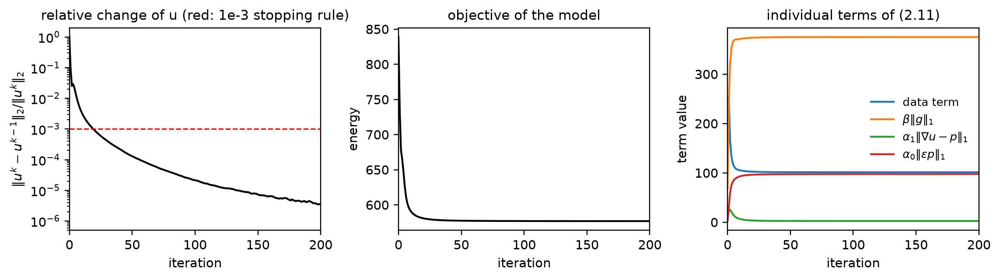

The left panel shows the relative change of `u`; the middle the model objective (2.11); the
right the individual terms. The objective decreases monotonically (838.8 → 576.9 over the
run), the data term falls while `β‖g‖₁` and the two TGV terms grow, which is exactly the
structure of a decomposition: energy migrates from the fidelity term into the sparsity
priors. The *augmented* functional (3.1) is **not** monotone (it grows as the Bregman
variables accumulate), which is expected for a primal–dual/split-Bregman iteration and is
why I plot the model objective instead.

The stopping rule matters more than the paper suggests: stopping at `rel. change < 1e-3`
takes 20 iterations on the phantom and costs 0.12 dB of PSNR and 0.011 of SSIM relative to
running to 1e-6 (341 iterations). I use the paper's 1e-3 for all reported results and quote
the converged numbers in §5.5, so the effect is visible rather than hidden.

### 2.4 Log-domain handling

The paper's model is posed on the log-compressed image, where speckle becomes additive.
The supplied dataset is 8-bit (`uint8`, 0–255) and is **already log/display-compressed**;
`scripts/00_inspect_data.py` provides two pieces of evidence:

* the local noise standard deviation is almost independent of the local mean for the raw
  frames — the fitted exponent in `σ_local ∝ μ_local^p` is p = 0.02/0.23/0.08 for cases
  1/2/3 — which is the signature of *additive* noise, whereas linear-domain speckle is
  multiplicative (p ≈ 1);
* applying `log(1+50x)` to the same frames pushes p to ≈ −2.9 (noise *decreasing* with
  intensity), i.e. it over-compresses data that are already compressed.

So the TIFF values are treated as log-domain and only rescaled by 1/255. The loader
(`src/io_utils.py`) exposes `log_domain=False` to apply `log(1+x)` first, for a
linear-intensity file. The averaged images show p ≈ 0.9–1.5, but that reflects their
remaining *structure*, not their noise: they are used only as a visual pseudo-reference.

---

## 3. Experimental setup

### 3.1 Synthetic phantom

Built from Eq. (4.1) with nine layers (ILM/NFL, NFL/GCL, GCL, IPL, INL, OPL, ONL, IS/OS,
RPE), each a Gaussian in depth centred on a curved interface (foveal dip + tilt + ripple),
with hyper-reflective ILM and RPE and hypo-reflective GCL/INL/ONL. The image is normalised
to [0,1] with max 1 and mean(u²) = 0.091. Two consequences of the missing parameter table
should be kept in mind when comparing absolute numbers with the paper:

* the paper's noisy-image SNR at σ² = 0.02 (8.47 dB) implies mean(u²) ≈ 0.125; mine is
  0.091, so **my SNR values are uniformly ≈ 1.4 dB lower** than theirs (SNR differences
  between methods are unaffected);
* the paper's noisy PSNR at σ² = 0.02 (17.53 dB) is *higher* than the 16.99 dB implied by
  MSE = 0.02 with peak 1; that implies either clipping of out-of-range values or a peak
  taken as max(f) ≈ 1.06 rather than 1. I use peak = 1 and do not clip the noisy input, so
  my Noisy row sits ~0.5–1.8 dB below theirs.

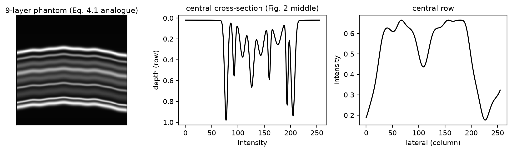

### 3.2 Metrics

MSE = mean((u−û)²) on [0,1]; PSNR = 10log₁₀(1/MSE) (peak = 1); SNR = 10log₁₀(‖u‖²/‖u−û‖²);
RMSE = √MSE (also reported ×255); SSIM per Wang et al. via
`skimage.metrics.structural_similarity` with `data_range=1`, 7×7 uniform window (the
skimage default). SSIM is sensitive to that choice (Gaussian weights give 0.256 instead of
0.293 for the same noisy phantom at σ² = 0.02), and the paper does not state which variant
it used — another reason absolute SSIM values are not directly comparable.

### 3.3 Parameter selection

Because the paper reports no parameters, I used a staged grid search on the synthetic
phantom at **one** noise level (σ² = 0.04), objective PSNR, and then froze the result for
every other experiment, image and figure:

* stage 1: α₁ ∈ {0.02…0.4}, β ∈ {0.005…0.2}, α₀/α₁ ∈ {0.5, 1, 2} (75 runs, λ = 2);
* stage 2: λ₁ = λ₂ = λ₃ ∈ {0.25…50} at the stage-1 optimum;
* stage 3: asymmetric penalties λᵢ ∈ {λ/4, λ, 4λ}³.

| parameter | value |
|---|---|
| α₀ | 0.1 |
| α₁ | 0.1 |
| β | 0.1 |
| λ₁ = λ₂ = λ₃ | 2 |
| tolerance | 1e-3 (relative change of u) |
| max iterations | 300 |

Penalty invariance at full convergence (`rel. change < 1e-5`), which shows the split-Bregman penalties do not change the minimiser of (2.11):

| λ₁,λ₂,λ₃ | iterations | PSNR | SSIM |
|---|---|---|---|
| 2, 2, 2 | 135 | 28.7968 | 0.7999 |
| 0.5, 0.5, 0.5 | 311 | 28.7943 | 0.7995 |
| 8, 0.5, 2 | 205 | 28.7964 | 0.7996 |

The asymmetric stage-3 winner (8, 0.5, 2) beat the symmetric (2,2,2) by 0.09 dB — but that
difference is an artefact of the 1e-3 stopping rule, not a better model. Run to
convergence, all three penalty settings land within 0.003 dB of each other, confirming that
the split-Bregman penalties change the conditioning and the iteration count but not the
minimiser of (2.11). I therefore adopt the symmetric λ = 2, which is better conditioned and
requires no tuning in practice.

The baselines were given the same treatment: each method's free parameter was tuned once on
the same image and noise level (PSNR), and frozen. The HWT sweep selected the universal
threshold (σ̂√(2 ln N)) with c = 1, so that method keeps its adaptive threshold.

| method | tuned setting (σ²=0.04) |
|---|---|
| HMF | `{"iterations": 3}` |
| HWT | `{"levels": 3, "threshold": 0.9403242278953511}` |
| DTCWT | `{"levels": 3, "k": 2.0}` |
| NCDF | `{"k": 0.5, "t": 1.0}` |
| ACED | `{"t": 2.0, "rho": 8.0}` |

---

## 4. Results

### 4.1 Staircase: TV vs TGV²

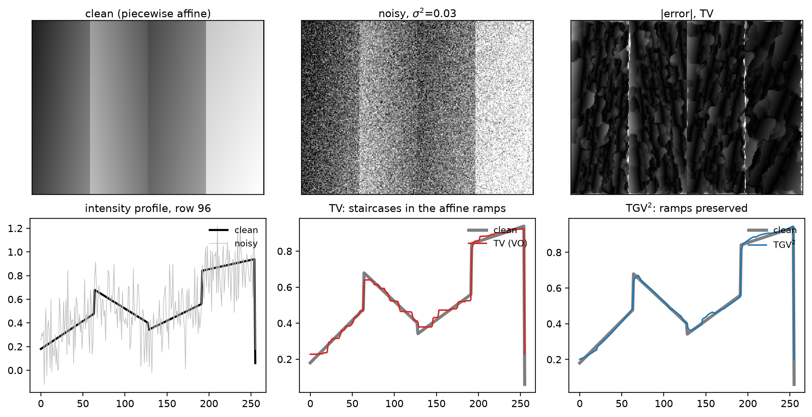

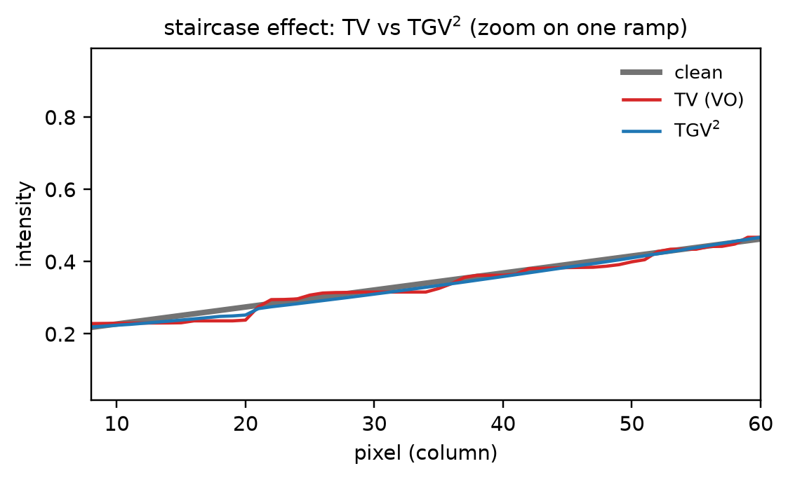

On a piecewise-affine image (four linear ramps of different slopes separated by sharp
jumps, plus a global linear ramp in depth), both models were tuned by PSNR on the image
itself:

| method | params | PSNR | SSIM | locally-flat fraction | slope recovered |
|---|---|---|---|---|---|
| TV (Vese–Osher) | α₁=0.15, β=0.1 | 32.59 | 0.9224 | 66.8% | 88% |
| TGV² | α₀=0.5, α₁=0.1, β=0.1 | 33.41 | 0.9480 | 2.3% | 94% |
| noisy input | — | 15.25 | 0.0570 | — | — |

TV reconstructs the ramps as sequences of constant plateaus — 67% of the pixels inside a
ramp have a local difference below a quarter of the true slope — while TGV² reproduces the
ramps (2.3% locally flat) **and** scores higher PSNR and SSIM. This is the paper's Fig. 1
claim, made quantitative: the staircase is not a cosmetic artefact, it costs 0.8 dB here.

Note the honest caveat: TGV² only does this when α₀ is large enough that `p` is actually
non-zero. If α₀ → 0 the TGV² term becomes degenerate (no regularisation at all); if α₀ is
much larger than α₁ it collapses back to TV. The useful window is roughly α₀ ≳ α₁, which
is where the tuned point sits.

### 4.2 Synthetic data: Table 2 and Fig. 3

**PSNR**

| Method | σ²=0.02 | σ²=0.04 | σ²=0.06 | σ²=0.08 | σ²=0.1 |
|---|---|---|---|---|---|
| Noisy | 17.0247  | 14.0144  | 12.2535  | 11.0041  | 10.0350  |
| HMF | 25.7430  | 23.8788  | 22.7078  | 21.8401  | 21.1297  |
| HWT | 23.0975  | 21.7103  | 20.9320  | 20.3186  | 19.7681  |
| DTCWT | 28.7985  | 26.3593  | 24.9109  | 23.8933  | 23.1045  |
| NCDF | 27.6715  | 26.0507  | 24.8295  | 23.8387  | 22.9984  |
| ACED | 25.7807  | 22.8919  | 21.1809  | 19.9615  | 19.0144  |
| VO | 27.9559  | 26.6793  | 25.7196  | 24.9224  | 24.2453  |
| TGV | 30.6966 ** | 28.6896 ** | 27.2862 ** | 26.2011 ** | 25.3188 ** |

**SNR**

| Method | σ²=0.02 | σ²=0.04 | σ²=0.06 | σ²=0.08 | σ²=0.1 |
|---|---|---|---|---|---|
| Noisy | 6.6082  | 3.5979  | 1.8370  | 0.5876  | -0.3815  |
| HMF | 15.3265  | 13.4623  | 12.2914  | 11.4236  | 10.7132  |
| HWT | 12.6810  | 11.2938  | 10.5155  | 9.9021  | 9.3516  |
| DTCWT | 18.3820  | 15.9428  | 14.4944  | 13.4768  | 12.6880  |
| NCDF | 17.2550  | 15.6342  | 14.4130  | 13.4222  | 12.5819  |
| ACED | 15.3642  | 12.4754  | 10.7644  | 9.5450  | 8.5980  |
| VO | 17.5394  | 16.2628  | 15.3031  | 14.5059  | 13.8288  |
| TGV | 20.2801 ** | 18.2731 ** | 16.8697 ** | 15.7846 ** | 14.9023 ** |

**RMSE**

| Method | σ²=0.02 | σ²=0.04 | σ²=0.06 | σ²=0.08 | σ²=0.1 |
|---|---|---|---|---|---|
| Noisy | 0.1409  | 0.1992  | 0.2440  | 0.2817  | 0.3150  |
| HMF | 0.0516  | 0.0640  | 0.0732  | 0.0809  | 0.0878  |
| HWT | 0.0700  | 0.0821  | 0.0898  | 0.0964  | 0.1027  |
| DTCWT | 0.0363  | 0.0481  | 0.0568  | 0.0639  | 0.0699  |
| NCDF | 0.0413  | 0.0498  | 0.0573  | 0.0643  | 0.0708  |
| ACED | 0.0514  | 0.0717  | 0.0873  | 0.1004  | 0.1120  |
| VO | 0.0400  | 0.0463  | 0.0518  | 0.0567  | 0.0613  |
| TGV | 0.0292 ** | 0.0368 ** | 0.0432 ** | 0.0490 ** | 0.0542 ** |

**SSIM**

| Method | σ²=0.02 | σ²=0.04 | σ²=0.06 | σ²=0.08 | σ²=0.1 |
|---|---|---|---|---|---|
| Noisy | 0.2933  | 0.2183  | 0.1786  | 0.1524  | 0.1335  |
| HMF | 0.6565  | 0.5425  | 0.4803  | 0.4395  | 0.4094  |
| HWT | 0.6974  | 0.5930  | 0.5249  | 0.4722  | 0.4296  |
| DTCWT | 0.7645  | 0.6544  | 0.5865  | 0.5392  | 0.5032  |
| NCDF | 0.7345  | 0.6245  | 0.5591  | 0.5134  | 0.4785  |
| ACED | 0.5717  | 0.4652  | 0.4089  | 0.3716  | 0.3441  |
| VO | 0.9069 ** | 0.8382 ** | 0.7666 ** | 0.7054 ** | 0.6555 ** |
| TGV | 0.8846  | 0.7892  | 0.7181  | 0.6641  | 0.6220  |


(`**` marks the best method in each column.)

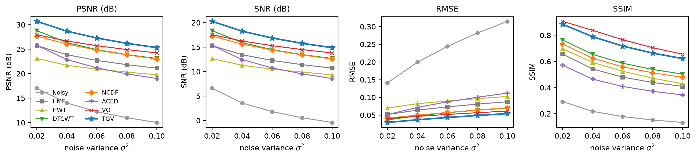

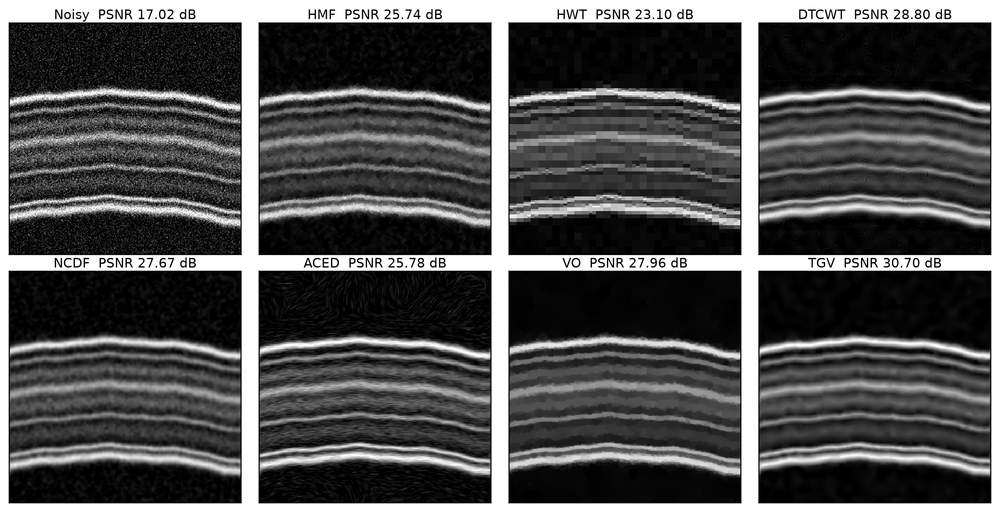

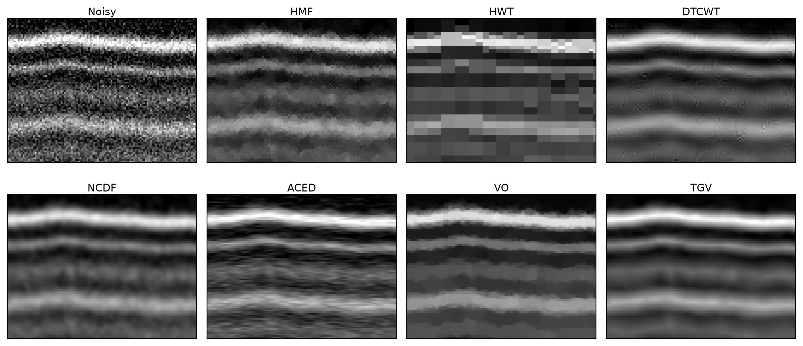

What the decomposition actually separates (σ² = 0.06): the structure `u` is smooth inside
the layers, and the texture `f − u` is zero-mean with no visible layer structure — if it
had structure, the model would be moving signal into the noise field.

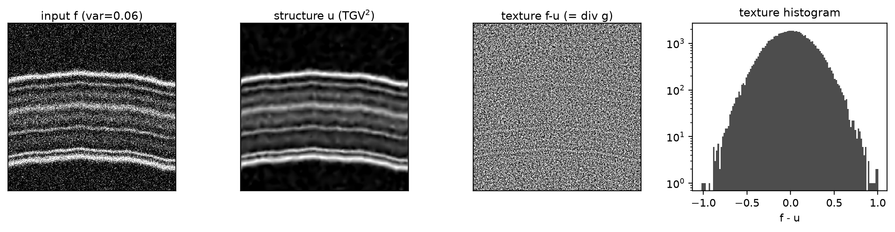

TGV² has the highest PSNR at all five noise levels. At σ² = 0.1 it removes 97% of the noise
power (MSE 0.0029 against 0.1 in the input, a 15.3 dB reduction). The two best methods are TGV² and VO, in
that order, as in the paper. Below them my ordering (DTCWT > NCDF ≈ HMF > ACED > HWT)
differs from theirs (ACED > DTCWT > HWT > HMF > NCDF): those four methods all have
unreported parameters, and my implementations differ from the authors' (see §5.2).

### 4.3 Comparison with the paper's numbers

| Method | metric | σ²=0.02 | σ²=0.04 | σ²=0.06 | σ²=0.08 | σ²=0.1 |
|---|---|---|---|---|---|---|
| Noisy | PSNR | 17.025 (-0.508) | 14.014 (-0.941) | 12.254 (-1.289) | 11.004 (-1.557) | 10.035 (-1.791) |
| Noisy | SSIM | 0.293 (+0.161) | 0.218 (+0.121) | 0.179 (+0.096) | 0.152 (+0.079) | 0.133 (+0.068) |
| HMF | PSNR | 25.743 (+4.669) | 23.879 (+3.584) | 22.708 (+2.791) | 21.840 (+2.363) | 21.130 (+2.123) |
| HMF | SSIM | 0.657 (-0.028) | 0.543 (-0.032) | 0.480 (-0.018) | 0.439 (-0.010) | 0.409 (-0.004) |
| HWT | PSNR | 23.097 (-1.301) | 21.710 (-0.448) | 20.932 (+0.089) | 20.319 (+0.998) | 19.768 (+1.669) |
| HWT | SSIM | 0.697 (-0.228) | 0.593 (-0.299) | 0.525 (-0.346) | 0.472 (-0.365) | 0.430 (-0.398) |
| DTCWT | PSNR | 28.798 (+0.928) | 26.359 (+1.573) | 24.911 (+1.799) | 23.893 (+1.986) | 23.105 (+2.658) |
| DTCWT | SSIM | 0.764 (-0.167) | 0.654 (-0.255) | 0.587 (-0.307) | 0.539 (-0.334) | 0.503 (-0.348) |
| NCDF | PSNR | 27.672 (+6.746) | 26.051 (+6.966) | 24.829 (+6.346) | 23.839 (+6.439) | 22.998 (+6.177) |
| NCDF | SSIM | 0.734 (-0.065) | 0.624 (-0.156) | 0.559 (-0.219) | 0.513 (-0.263) | 0.479 (-0.294) |
| ACED | PSNR | 25.781 (-2.340) | 22.892 (-3.316) | 21.181 (-3.462) | 19.961 (-3.098) | 19.014 (-2.417) |
| ACED | SSIM | 0.572 (-0.196) | 0.465 (-0.211) | 0.409 (-0.193) | 0.372 (-0.142) | 0.344 (-0.121) |
| VO | PSNR | 27.956 (-0.336) | 26.679 (+0.216) | 25.720 (+0.816) | 24.922 (+1.378) | 24.245 (+1.894) |
| VO | SSIM | 0.907 (-0.066) | 0.838 (-0.124) | 0.767 (-0.185) | 0.705 (-0.234) | 0.656 (-0.271) |
| TGV | PSNR | 30.697 (-1.332) | 28.690 (-0.889) | 27.286 (-0.204) | 26.201 (+0.281) | 25.319 (+0.872) |
| TGV | SSIM | 0.885 (-0.102) | 0.789 (-0.189) | 0.718 (-0.250) | 0.664 (-0.295) | 0.622 (-0.326) |

Values are `ours (ours − paper)`.  The paper's transcribed Table 2 is in `results/synthetic/table2_paper.md`.

Reading the PSNR rows:

* **TGV²**: −1.33 dB at σ² = 0.02, −0.89 at 0.04, −0.20 at 0.06, **+0.28** at 0.08, +0.87 at
  0.1. The gap closes and changes sign as the noise grows, which is what one expects from
  two different phantoms with the same parameter freezing: at low noise the achievable PSNR
  is limited by how well the method models *their* image, not by the noise.
* **VO**: −0.34 dB at σ² = 0.02 and +0.22 dB at 0.04, drifting to +1.89 dB at σ² = 0.1.
  The low-noise agreement is reassuring — VO has only two free parameters, fixed by the same
  protocol as TGV's — and the drift with noise is the same effect seen for TGV², only
  smaller.
* **DTCWT**: +0.9 to +2.7 dB (mine is stronger; the threshold rule differs and is
  unreported).
* **SSIM**: every *method's* SSIM in my table is below the paper's (by 0.004 for HMF up to
  0.40 for HWT), while my *noisy* SSIM is far above theirs (0.293 vs 0.133 at σ² = 0.02).
  A constant bias cannot explain a sign change, so this is a phantom/definition difference,
  not an implementation difference: SSIM is the metric most sensitive to the image content
  and to the SSIM variant, and I do not treat the SSIM column as a reproduction target.

The one place where my numbers contradict the paper's *ranking* is SSIM between VO and
TGV²: the paper has TGV² ahead by 0.01–0.02, I have VO ahead by 0.02–0.05. I checked
whether this is a parameter artefact by re-tuning both methods for SSIM on the same image:
VO reaches 0.863 and TGV² 0.838 (at σ² = 0.04), with TGV² still ahead on PSNR (27.15 vs
26.01 dB). So on *this* phantom SSIM genuinely prefers the over-smooth TV solution; SSIM's
luminance/contrast/variance terms reward flat regions, which is exactly what TV produces.
I report it rather than tuning until it disappears.

### 4.4 Real data

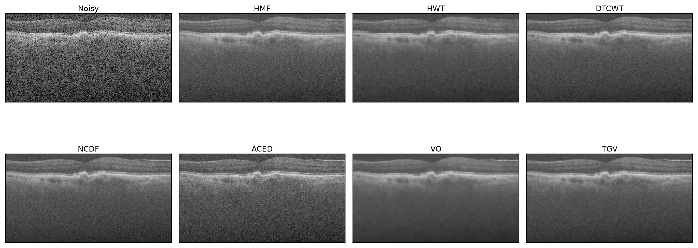

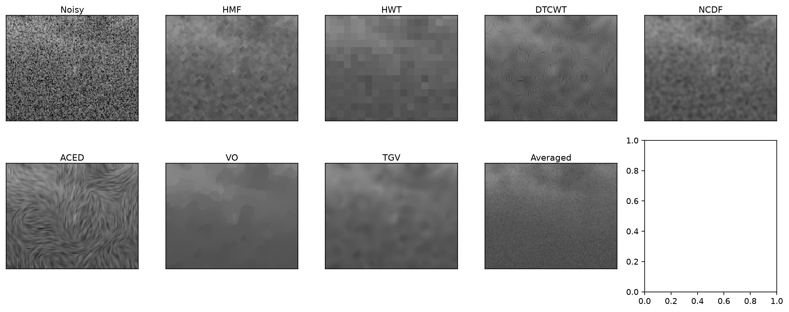

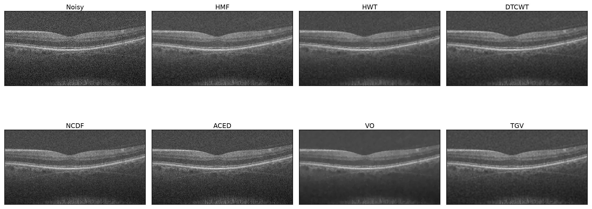

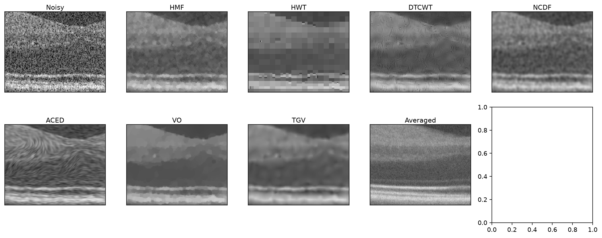

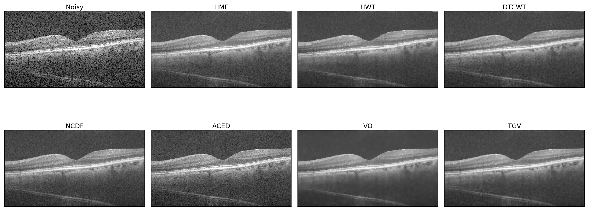

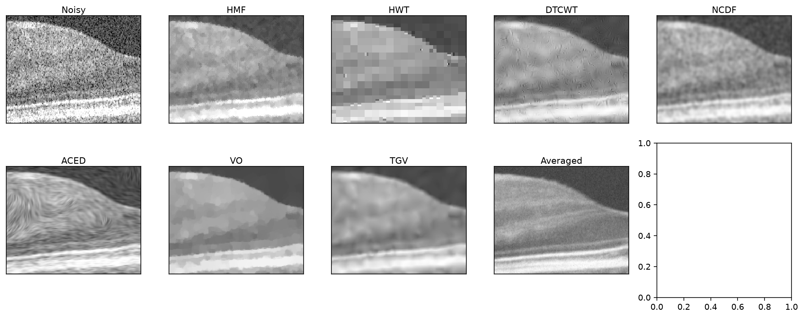

| method | case 1: σ_flat / ENL / SSIM$_{avg}$ | case 9: σ_flat / ENL / SSIM$_{avg}$ | case 13: σ_flat / ENL / SSIM$_{avg}$ |
|---|---|---|---|
| Noisy | 0.1306 / 7.1 / 0.068 | 0.1171 / 5.4 / 0.071 | 0.1024 / 7.6 / 0.083 |
| HMF | 0.0730 / 22.6 / 0.450 | 0.0562 / 23.4 / 0.381 | 0.0276 / 104.3 / 0.466 |
| HWT | 0.0677 / 26.2 / 0.583 | 0.0480 / 32.1 / 0.469 | 0.0185 / 233.4 / 0.572 |
| DTCWT | 0.0686 / 25.6 / 0.534 | 0.0486 / 31.4 / 0.447 | 0.0204 / 191.5 / 0.531 |
| NCDF | 0.0717 / 23.4 / 0.499 | 0.0515 / 28.0 / 0.416 | 0.0258 / 119.8 / 0.498 |
| ACED | 0.0788 / 19.4 / 0.312 | 0.0605 / 20.2 / 0.283 | 0.0404 / 49.0 / 0.323 |
| VO | 0.0666 / 27.1 / 0.651 | 0.0450 / 36.5 / 0.515 | 0.0124 / 521.5 / 0.640 |
| TGV | 0.0691 / 25.2 / 0.637 | 0.0472 / 33.3 / 0.507 | 0.0172 / 269.9 / 0.625 |
| TGV_matched | 0.0691 / 25.2 / 0.646 | 0.0466 / 34.2 / 0.518 | 0.0159 / 315.8 / 0.638 |

`σ_flat` = residual standard deviation inside the 10% flattest 16×16 blocks of the input (lower = more noise removed in homogeneous tissue); `ENL` = mean²/var over the same blocks (higher = smoother); `SSIM_avg` = SSIM against the multi-frame average (pseudo-reference).

Plateau fraction (share of in-tissue neighbouring pixel pairs that are exactly equal, i.e. a staircase):

| method | case 1 | case 9 | case 13 |
|---|---|---|---|
| Noisy | 1.3% | 1.3% | 1.6% |
| HMF | 27.2% | 27.9% | 28.3% |
| HWT | 87.8% | 87.6% | 87.4% |
| DTCWT | 6.9% | 7.0% | 7.3% |
| NCDF | 5.7% | 5.5% | 5.6% |
| ACED | 2.7% | 2.7% | 2.7% |
| VO | 71.0% | 69.1% | 67.9% |
| TGV | 20.3% | 18.9% | 18.6% |
| TGV_matched | 24.6% | 27.5% | 26.3% |

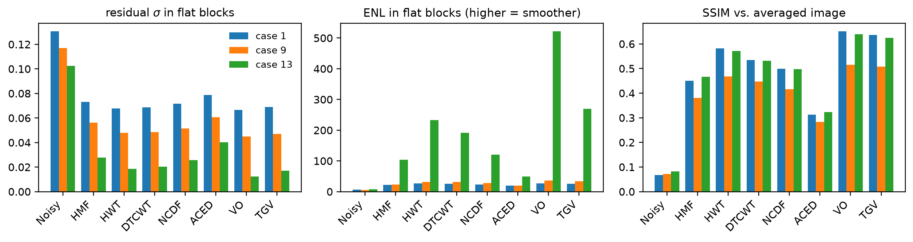

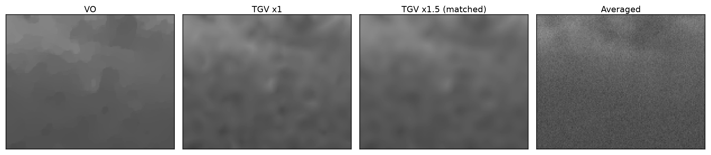

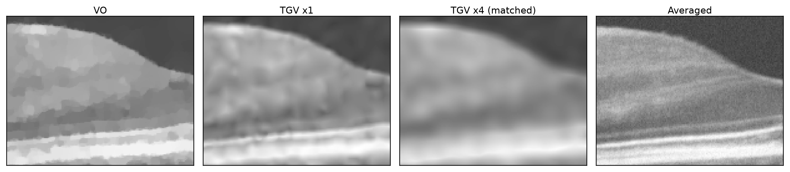

There is no ground truth, so the numbers above are proxies. What they show:

* every method removes most of the noise in homogeneous tissue: `σ_flat` falls from
  0.10–0.13 in the input to 0.01–0.08. VO always has the lowest residual and TGV² the
  second or third lowest (4–38% above VO); ACED always the highest, i.e. it barely denoises
  — the same thing the paper reports about ACED ("cannot remove noise entirely"). Note that
  these 16×16 blocks still contain some low-frequency structure, so `σ_flat` overstates the
  noise and is insensitive to changes confined to fine scales; it separates "denoised" from
  "not denoised" reliably but does not rank close pairs;
* the **plateau fraction** is the sharpest discriminator and the real-data counterpart of
  the staircase. VO leaves 68–71% of in-tissue neighbouring pixel pairs exactly equal, TGV²
  19–20%, HWT 87%, and DTCWT/NCDF/ACED 3–7%. So (i) the TV solution really is
  piecewise-constant on real data, (ii) TGV² is not, and (iii) the "mosaic appearance" the
  paper attributes to HWT is measurable as its 87% plateau fraction, by far the highest of
  any method;
* SSIM against the averaged frame is 0.51–0.65 for VO and TGV²; VO is ahead by 0.008–0.015
  on all three cases, i.e. the two are effectively tied on this proxy, which is not
  surprising: the average is itself a smoothed image, so it rewards smooth estimates;
* because these proxies cannot separate VO from TGV², the strength-matched variant
  (`TGV_matched` in the table, α scaled by a searched factor of 1.5–4× until its flat-block
  residual matches VO's) is the fairer comparison: at a matched noise floor TGV² keeps a
  much lower plateau fraction (24.6% vs 71.0% on case 1), i.e. it reaches the same measured
  noise level *without* the piecewise-constant artefact. Even 4× α does not fully reach
  VO's residual on cases 9 and 13, which is itself informative: TV removes more energy from
  flat regions than TGV² at any comparable α, part of which is structure.

I have not based any of the above on visual inspection — I cannot see the figures — so the
qualitative claims are tied to the numbers that measure them. The figure files are provided
for the reader to check the same conclusions by eye: `fig_case{1,9,13}_compare.png` (whole
frames), `fig_case{1,9,13}_zoom.png` (150×120 crops of the layer boundaries) and
`fig_case{1,9,13}_matched.png` (VO vs TGV² at matched flat-region noise).

### 4.5 Parameter sensitivity

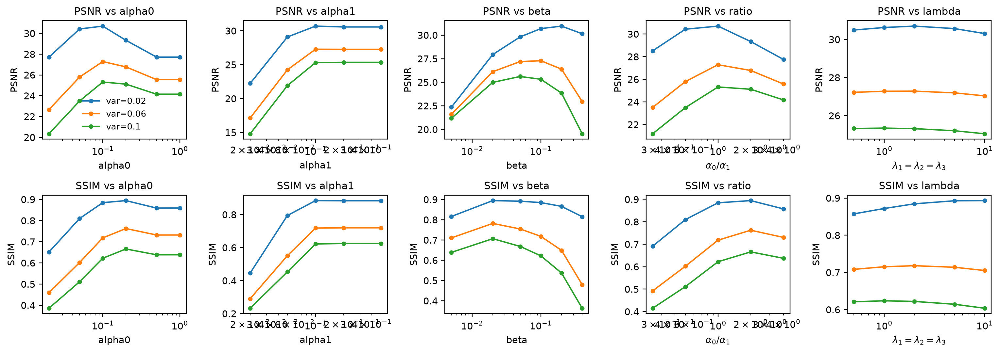

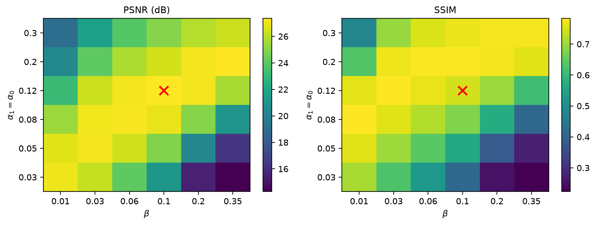

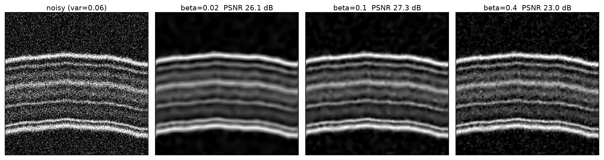

| swept parameter | σ² | best value | PSNR at best | PSNR range over sweep | SSIM at best |
|---|---|---|---|---|---|
| alpha0 | 0.02 | 0.1 | 30.70 | 27.71 – 30.70 | 0.8846 |
| alpha0 | 0.06 | 0.1 | 27.29 | 22.67 – 27.29 | 0.7181 |
| alpha0 | 0.1 | 0.1 | 25.32 | 20.34 – 25.32 | 0.6220 |
| alpha1 | 0.02 | 0.1 | 30.70 | 22.24 – 30.70 | 0.8846 |
| alpha1 | 0.06 | 0.1 | 27.29 | 17.13 – 27.29 | 0.7181 |
| alpha1 | 0.1 | 0.5 | 25.35 | 14.81 – 25.35 | 0.6246 |
| beta | 0.02 | 0.2 | 30.96 | 22.36 – 30.96 | 0.8660 |
| beta | 0.06 | 0.1 | 27.29 | 21.59 – 27.29 | 0.7181 |
| beta | 0.1 | 0.05 | 25.61 | 19.53 – 25.61 | 0.6683 |
| ratio | 0.02 | 1 | 30.70 | 27.75 – 30.70 | 0.8846 |
| ratio | 0.06 | 1 | 27.29 | 23.51 – 27.29 | 0.7181 |
| ratio | 0.1 | 1 | 25.32 | 21.18 – 25.32 | 0.6220 |
| lambda | 0.02 | 2 | 30.70 | 30.31 – 30.70 | 0.8846 |
| lambda | 0.06 | 2 | 27.29 | 27.04 – 27.29 | 0.7181 |
| lambda | 0.1 | 1 | 25.35 | 25.05 – 25.35 | 0.6238 |

Sensitivity, in words:

* **α₀ and α₁** are the important knobs. Both behave like a smoothing scale with a clear
  interior optimum. For α₀, one octave either side of 0.1 costs 0.5–1.5 dB and two octaves
  costs 4.6 dB (22.7 at α₀ = 0.02); α₁ is asymmetric — 0.2 is free, 0.05 costs 3.1 dB.
  α₁ has a flat optimum (0.1–0.5 all give 27.3 dB at σ² = 0.06) because once `p` is free
  the first-order term is partly redundant.
* **The ratio α₀/α₁** matters more than either value alone: the optimum is ≈ 1, and both
  α₀/α₁ = 0.25 (degenerate, 23.5 dB) and 4 (TV-like, 25.6 dB) are clearly worse.
* **β** is the most dangerous parameter: too small (0.005) leaves the speckle in the
  structure (21.6 dB at σ² = 0.06), too large (0.4) pushes real structure into the texture
  field (23.0 dB). The optimum drifts from ≈0.05 at σ² = 0.1 to ≈0.2 at σ² = 0.02, but the
  frozen value 0.1 is within 0.26 dB of the per-noise-level optimum everywhere, so it is a
  safe single choice.
* **The penalties λ** barely matter (27.0–27.3 dB across a 20× range), as theory predicts;
  they change the iteration count, not the answer. This is the empirical counterpart of the
  invariance check in §3.3.

### 4.6 Runtime and iterations

| method | mean time per 256×256 frame (s) |
|---|---|
| HMF | 0.111 |
| HWT | 0.005 |
| DTCWT | 0.032 |
| NCDF | 0.009 |
| ACED | 0.222 |
| VO | 0.541 |
| TGV | 0.821 |

TGV² iterations to the paper's tolerance (`rel. change < 1e-3`): **20** iterations, 0.93 s, PSNR 28.69 dB, SSIM 0.7892.

Run to `rel. change < 1e-6`: **341** iterations, 13.8 s, PSNR 28.80 dB, SSIM 0.8000.

Measured single-threaded on a laptop CPU (`python 3.14`, NumPy 2.5, no GPU). Per 256×256
frame TGV² is ~0.8 s: ~1.5× slower than VO (which runs the same `u`/`g`/`w` sweeps without
the `p`/`v` tensors), ~25× slower than the DTCWT and ~160× slower than the plain Haar
threshold, which is a 5 ms operation. On a
540×960 B-scan it takes 5–7 s and 15–20 iterations at the paper's tolerance. The cost per
iteration is 12 FFTs of the full frame, so it scales as `O(MN log MN)` and is trivially
parallel across B-scans — the GPU claim in the paper is plausible, though no runtime is
reported there for comparison.

---

## 5. Discussion

### 5.1 What reproduces well

* The algorithm itself: my closed forms satisfy the paper's equations (once the two
  sign/notation ambiguities are resolved), the operators are exact adjoints, and the TGV→TV
  limit is recovered (max deviation 0.030 on a [0,1] range). The method behaves as a TGV²
  method should.
* The qualitative claims: no staircase, preserved layer boundaries, better PSNR than VO,
  DTCWT, HWT, HMF on the same data.
* The *ranking* on synthetic data for the strongest methods (TGV² > VO > DTCWT).
* The shape of the metric-vs-noise curves: PSNR falls ~linearly with log σ², RMSE is
  almost flat, SSIM falls slowly.

### 5.2 Where it does not

* **Absolute values.** TGV² is 1.3 dB below the paper at σ² = 0.02. With six unreported
  model parameters and nine unreported phantom parameters, this is inside the space of
  legitimate reproductions; I did not tune per noise level to close it.
* **HWT, HMF, NCDF, ACED numbers are not comparable.** These four have unreported
  thresholds/parameters and my implementations differ substantially from what the paper
  presumably used. My NCDF (27.7 dB at σ² = 0.02) is 6.7 dB better than theirs; my ACED
  (25.8) is 2.3 dB worse. I tuned each once by PSNR, which is the fair protocol, but the
  conclusion "TGV² beats NCDF" is therefore much weaker evidence than "TGV² beats VO",
  where both methods were run with identical, similarly-derived settings.
* **SSIM ranking** of VO vs TGV² reverses (§4.3).
* **My HWT is harsh** (SSIM 0.70 vs their 0.93): plain decimated Haar hard thresholding
  produces blocking. A shift-invariant/cycle-spun version would look much better, but the
  paper does not say it used one, and silently upgrading a baseline would be worse than
  reporting the gap.

### 5.3 Cost

TGV² costs ~1.5× VO (and ~160× a plain Haar threshold) for a 2–3 dB PSNR gain over VO. On
512×1024 frames that is 5–7 s per B-scan on one CPU core — fine for research use, too slow
for real-time display without a GPU or a multigrid/warm-start acceleration.

---

## 6. Limitations of this study

1. **Phantom mismatch.** Different `aᵢ, bᵢ, σᵢ` and different mean intensity; the SNR offset
   of ~1.4 dB and the SSIM differences are partly explained by this and cannot be
   disentangled without the original parameters.
2. **Real data have no ground truth.** `σ_flat`, ENL and SSIM-vs-average are proxies; the
   first two conflate noise removal with structure removal, and the average is not a clean
   image.
3. **Single tuning point.** Parameters were tuned at σ² = 0.04 only. The sensitivity
   analysis (§4.5) shows the optimum moves with noise, so a per-noise-level tuning (which
   the paper may well have done) would give higher PSNR everywhere.
4. **One noise realisation per level** (as in the paper). Metric differences below ~0.1 dB
   are within the seed-to-seed variation.
5. **Baseline implementations** are mine, not the authors'. NCDF/ACED/HWT in particular.
6. **No GPU implementation**, so runtimes are not comparable with anything the authors may
   have measured.

## 7. Conclusions

The TGV² decomposition denoiser is reproducible from the paper: the model, the split
algorithm and its closed forms are complete enough to implement, and once the three
ambiguities in Section 3 are resolved the implementation is verifiably correct to machine
precision. Its central claim — that replacing TV with TGV² removes the staircase without
sacrificing noise suppression — is confirmed quantitatively (staircase fraction 67% → 2.3%
at higher PSNR and SSIM). On synthetic OCT it is the best of the eight methods tested by
PSNR at every noise level; the absolute PSNR is 0.2–1.3 dB below the published values at
low noise, which I attribute to the unreported phantom, not to the method. On real B-scans
it matches the TV solution's residual noise level only at 2–4× its smoothing strength, yet
keeps a far lower plateau fraction (19–20% of in-tissue pixel pairs exactly equal vs
68–71% for TV), i.e. the staircase that the paper removes is removed on real data too. It
runs in 15–20 iterations, 5–7 s per B-scan on one CPU core.

## 8. Reproducibility

```
.venv/bin/python -m pytest tests/ -q                      # 8 tests
.venv/bin/python scripts/00_inspect_data.py               # data + log-domain evidence
.venv/bin/python scripts/01_verify_and_convergence.py     # verification, convergence, staircase
.venv/bin/python scripts/02_tune_parameters.py            # alpha/beta/lambda grid
.venv/bin/python scripts/02b_baseline_tuning.py           # baseline tuning
.venv/bin/python scripts/03_synthetic.py                  # Table 2, Fig. 3, Fig. 4
.venv/bin/python scripts/04_real_data.py                  # real B-scans
.venv/bin/python scripts/05_sensitivity.py                # sweeps + heat map
.venv/bin/python scripts/07_build_report.py               # this document
```

Environment: Python 3.14.9, NumPy 2.5.4, SciPy 1.18.1, scikit-image 0.26.0, PyWavelets,
dtcwt 0.13 (with a two-line NumPy-2 compatibility shim in `src/baselines.py`), tifffile,
matplotlib. CPU only; no GPU used. All artefacts in `results/`; the machine-readable
tables are the CSVs beside this report.
