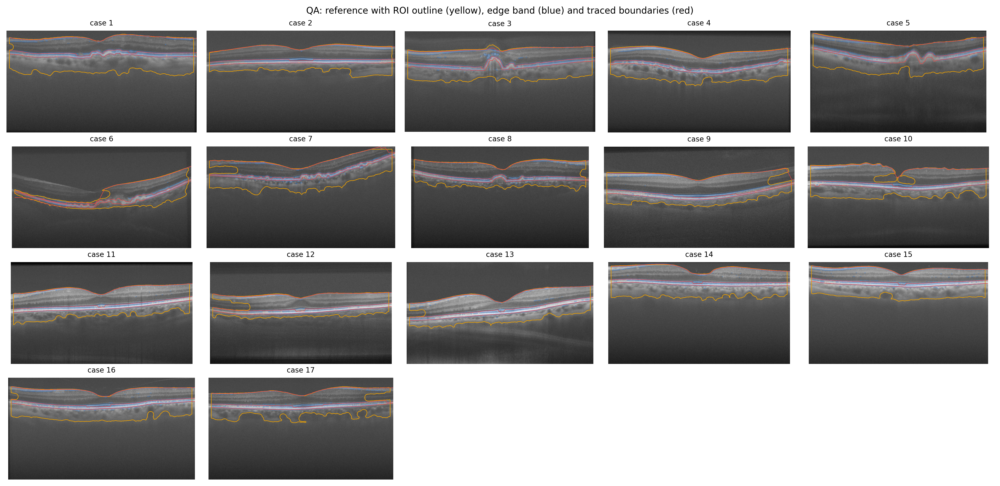
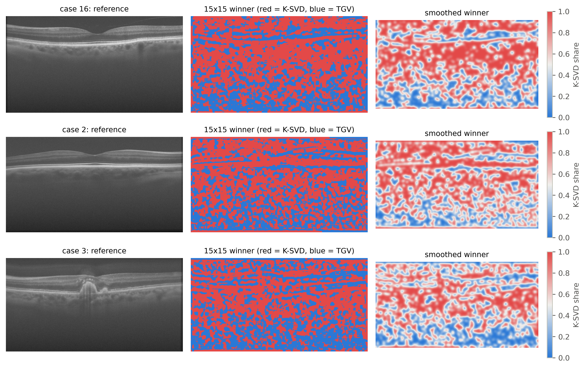
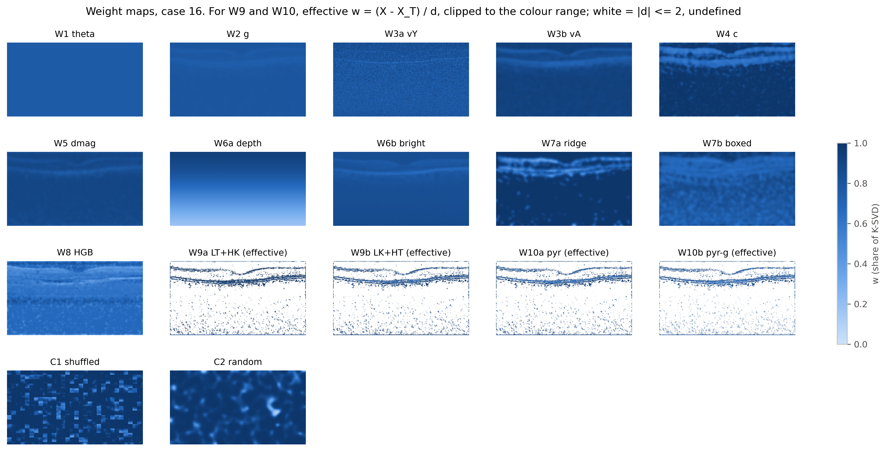
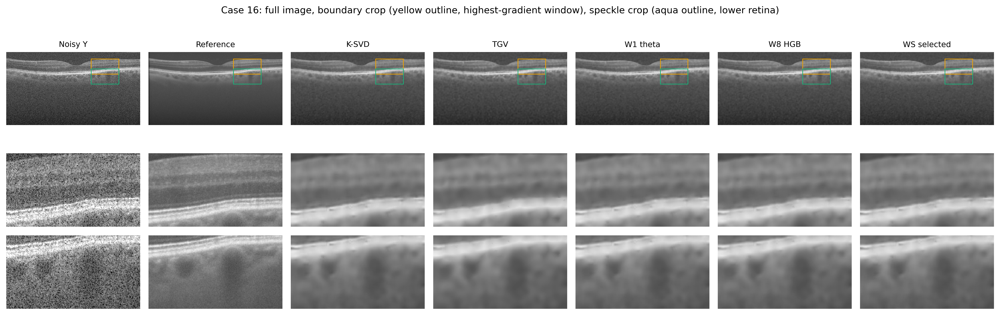
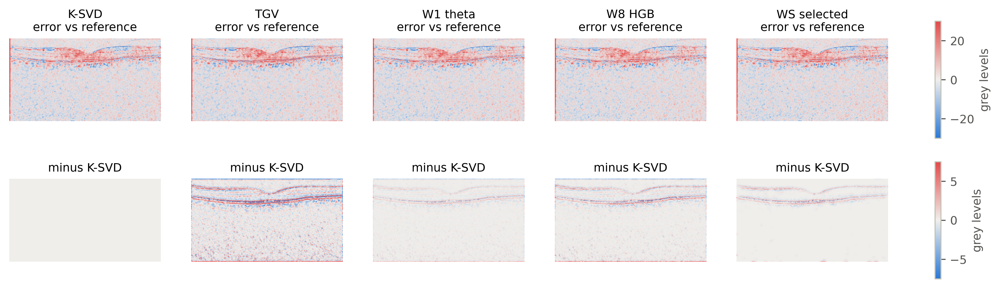
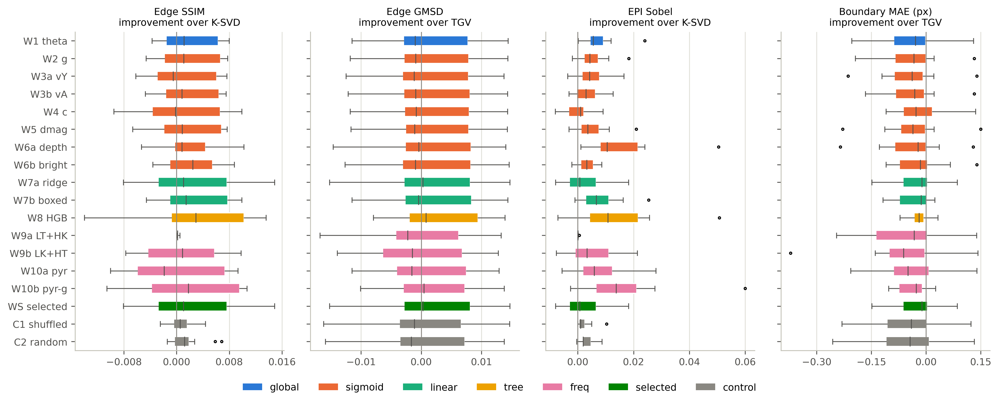
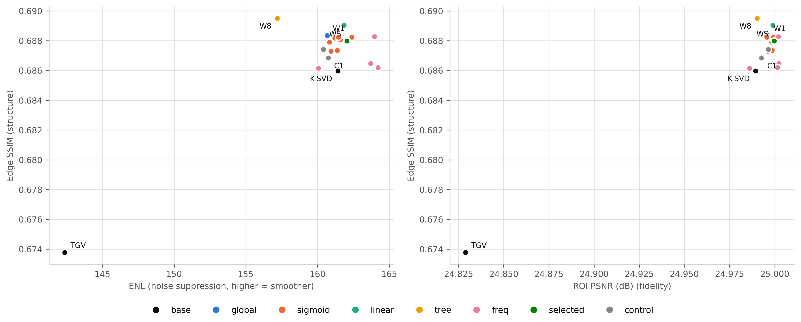
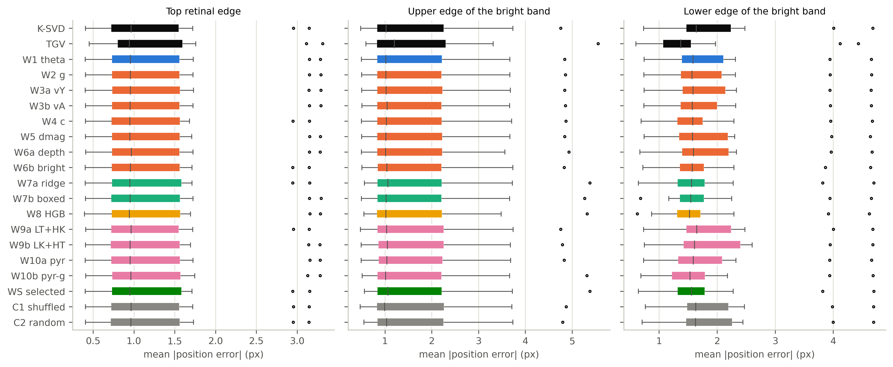
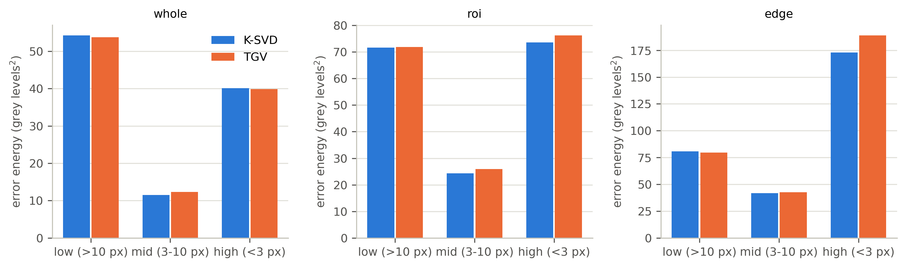
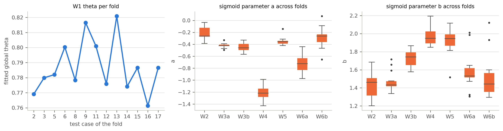

# The fusion study explained: every term and every plot

This guide explains what the fusion study did, what its terms mean, and how to read each of its 10 plots. All numbers come from the full run on 13 scored images, and all plots are in `figures/`.

**Contents**

1. [The result in one minute](#1-the-result-in-one-minute)
2. [The basic terms](#2-the-basic-terms)
3. [The image regions: ROI, edge band and others](#3-the-image-regions-roi-edge-band-and-others)
4. [The methods and their colours](#4-the-methods-and-their-colours)
5. [The features: what a method can see](#5-the-features-what-a-method-can-see)
6. [The metrics: how quality is scored](#6-the-metrics-how-quality-is-scored)
7. [The testing and statistics terms](#7-the-testing-and-statistics-terms)
8. [Every plot, one by one](#8-every-plot-one-by-one)
9. [All the numbers](#9-all-the-numbers)

---

## 1. The result in one minute

**The question:** K-SVD and TGV each clean up a noisy OCT scan. Can we get better edges and layer boundaries by mixing them differently at each pixel, without bringing noise back?

**The answer: not reliably.** Compared with K-SVD, the better method on most metrics:

| Goal | What happened |
|---|---|
| Edge SSIM (the main score) | No method reliably improves it. The highest, W8, gains +0.0035, which could be zero (CI [-0.0009, +0.0076]). |
| Spatial weights vs one fixed weight | On edge SSIM, no method beats the fixed weight (W1). On EPI, W6a and W10b do, by a small amount. |
| Edge preservation (EPI) | A small, real gain from blending: W1 gains +0.007, better on all 13 images. |
| Boundary position | No real change. Every method is within 0.07 px of the others on average. |
| **Boundary sharpness** | **Fusion is worse than K-SVD.** Boundaries get 0.4 to 0.9 px softer with most methods, because blending in TGV softens them. |
| Noise suppression | About the same as K-SVD. |

**Why so little changes:** K-SVD and TGV make nearly the same errors (correlation 0.97), and no feature predicts well where to favour one over the other.

---

## 2. The basic terms

| Term | Meaning |
|---|---|
| **OCT** | Optical coherence tomography. It images the layers of the retina using light, a bit like ultrasound uses sound. |
| **B-scan** | One cross-section image of the retina. Layers appear as horizontal bands. Each image in this study is one B-scan. |
| **Speckle** | The grainy noise in OCT images. |
| **Case** | One eye's data: a noisy scan and its reference. There are 17, numbered 1 to 17. |
| **`Y` (noisy input)** | The raw single-frame scan. |
| **Reference** | Many scans of the same place averaged together. It's the closest thing to a clean answer, but it isn't perfect: it has leftover grain and is smoother than one scan. |
| **`X_K`** | The K-SVD result. K-SVD rebuilds the image from small patches using a learned dictionary of typical patterns. |
| **`X_T`** | The TGV result. TGV smooths the image while trying to keep edges and gradual slopes. |
| **`d`** | `X_K − X_T`, the difference between the two results. |
| **`w` (weight)** | K-SVD's share at a pixel. The output is `X = w·X_K + (1−w)·X_T`, so `w = 1` is all K-SVD and `w = 0` is all TGV. |
| **`θ` (theta)** | The single fixed weight used by W1. |
| **Weight map** | An image showing `w` at every pixel. |
| **Fusion** | Combining `X_K` and `X_T` into one image. |
| **Grey level** | Pixel brightness, from 0 (black) to 255 (white). Errors are measured in these units. |
| **Log-compressed** | The stored images have already had their brightness range compressed. No further log step is applied. |
| **px** | Pixel. Boundary errors and widths are measured in pixels. |
| **Gaussian blur, `σ` (sigma)** | A soft blur. A larger `σ` averages over a wider area. |
| **Gradient** | How quickly brightness changes between neighbouring pixels. A large gradient means an edge. |
| **Frequency / scale** | Low frequency is broad, slow changes in brightness. High frequency is fine detail, and also speckle. |

---

## 3. The image regions: ROI, edge band and others

Scores are calculated over different parts of the image, because the empty dark area would otherwise dominate.

| Region | What it is | How it's made |
|---|---|---|
| **Whole image** | Every pixel, including the empty dark areas. | |
| **ROI (region of interest)** | The retina and the tissue below it. | Blur the reference, split bright from dark with an automatic threshold (Otsu), close small gaps, keep the largest connected piece, fill holes, and drop the first 15 columns because they have a dark strip. |
| **Edge band** | Thin strips around the strongest edges, which is where structure matters most. | Take the 10% of ROI pixels with the strongest reference gradient, then widen them by 2 px. |
| **Flat blocks** | Areas that should be uniform, used for noise scores. | Split the image into 16×16 blocks and keep the 10% with the lowest variation in the reference. |
| **Foreground and background windows** | Used for CNR and MSR. | The 5 brightest 24×24 windows are foreground; the darkest window above the retina is background. |
| **The three boundaries** | The layer edges used for position and sharpness scores. | The top edge of the retina, plus the upper and lower edges of the brightest band. See "Tracer" in section 6. |

All regions come from the reference. They're used for fitting on training images and for scoring, and no method can see them on a test image.

---

## 4. The methods and their colours

Plots use one colour per method family:

| Colour | Family | Methods |
|---|---|---|
| Black | Base | K-SVD, TGV |
| Blue | Global | W1 |
| Orange | Sigmoid (one feature) | W2, W3a, W3b, W4, W5, W6a, W6b |
| Aqua | Linear (all features) | W7a, W7b |
| Yellow | Tree | W8 |
| Pink | Frequency | W9a, W9b, W10a, W10b |
| Green | Selected | WS |
| Grey | Control | C1, C2 |

| Code | Name | How it decides the mix |
|---|---|---|
| **W1 theta** | Fixed weight | One number for the whole image, found by least squares. Averages 0.787, or about 79% K-SVD. |
| **W2 g** | Edge strength | `w = sigmoid(a·z + b)`, where `z` is the edge-strength feature. |
| **W3a vY** | Noisy variance | The same curve, using local variance of the noisy image. |
| **W3b vA** | Averaged variance | The same curve, using local variance of the K-SVD and TGV average. |
| **W4 c** | Coherence | The same curve, using how clearly the local pattern runs in one direction. |
| **W5 dmag** | Disagreement | The same curve, using how much K-SVD and TGV differ locally. |
| **W6a depth** | Depth | The same curve, using the row number. It ignores image content. |
| **W6b bright** | Brightness | The same curve, using local brightness. |
| **W7a ridge** | Linear | Adds up all the features with fitted weights, then clips to 0–1. |
| **W7b boxed** | Constrained linear | The same, but fitted so `w` stays within 0–1 on the training pixels. |
| **W8 HGB** | Gradient boosting | 100 small decision trees that predict the best local mix. The most prone to overfitting. |
| **W9a LT+HK** | Frequency split | Coarse detail from TGV, fine detail from K-SVD. Picked a blur of `σ = 20` on every case I checked, so only TGV's very broadest brightness is used, which is why it's almost identical to K-SVD. |
| **W9b LK+HT** | Swapped split | Coarse detail from K-SVD, fine detail from TGV. Picked `σ = 1` on the same cases. |
| **W10a pyr** | Pyramid | Splits `d` into 4 levels of detail, with one fixed weight per level. On the case 16 fold, finest to coarsest: 0.41, 0.70, 1.00, 1.00. |
| **W10b pyr-g** | Pyramid + edges | The same, but each level's weight also changes with edge strength. |
| **WS selected** | Fair pick | In each fold, picks the best of W2–W8 using training images only. It chose W7a all 13 times, so its scores equal W7a's. |
| **C1 shuffled** | Control | WS's weight map, cut into 32×32 blocks and scrambled. Same values, wrong places. |
| **C2 random** | Control | A smooth random map with the same average weight. |

**Reading the sigmoid.** `sigmoid` is an S-shaped curve that always gives a value between 0 and 1.
- `b` sets the base mix. When the feature is average (`z = 0`), `w = sigmoid(b)`, so `b = 1.45` gives about 0.81.
- `a` sets how strongly the feature changes the mix. A negative `a` means a higher feature value gives less K-SVD and more TGV.

**Weight smoothing (W2–W8).** A weight map can be smoothed to avoid visible seams, using a Gaussian blur or a guided filter (a blur that follows image edges). The training images choose which to use, including none.

---

## 5. The features: what a method can see

On a test image, a method can only use `X_K`, `X_T` and `Y`. `A` is the average of `X_K` and `X_T`.

| Feature | Meaning | High value means |
|---|---|---|
| **`g`** | Gradient strength of `A` | A strong edge |
| **`vY`** | Local variance of `Y` | A busy area of the noisy image |
| **`vA`** | Local variance of `A` | A busy area of the denoised image |
| **`c`** | Structure-tensor coherence | The pattern runs in one direction, like a layer |
| **`dmag`** | Smoothed `|X_K − X_T|` | The two methods disagree |
| **`depth`** | Row number ÷ image height | Lower in the image |
| **`bright`** | Smoothed brightness of `A` | Bright tissue |

**Scale `s`:** how much a feature is smoothed first (1, 2 or 4). The training images choose it.

**`z` (standardised value):** the feature rescaled using training statistics, so `z = 0` is average and `z = +2` is unusually high.

**How much the features help:** none predicts the best local mix well. The rank correlations with it are all weak, and the strongest is only -0.09 (coherence).

---

## 6. The metrics: how quality is scored

### Structure (the main goal)

| Metric | What it asks | Better | How it works |
|---|---|---|---|
| **Edge SSIM** (primary) | Does local structure match the reference near edges? | Higher | SSIM averaged over the edge band. |
| **SSIM** | Do brightness, contrast and pattern match locally? | Higher | Compares small 11×11 Gaussian windows. 1 means identical. |
| **Edge PSNR** | How close are the pixel values near edges? | Higher | PSNR over the edge band. |
| **Edge GMSD** | How consistently do the edge strengths match near edges? | Lower | Compares gradient strength at each pixel, then takes the spread of that similarity. 0 means perfectly consistent. |
| **EPI Sobel** | Are edges in the same places, with the same relative strength? | Higher | Correlation between the Sobel edge maps of the output and the reference, over the whole image. 1 is a perfect match. |
| **EPI Laplacian** | The same idea, using a second-derivative edge map | Higher | Uses a blur of `σ = 1` first, because the plain version rewards noise on this data. |
| **Boundary MAE** | How far is each traced boundary from the reference's? | Lower | Mean absolute difference in rows, in px, averaged over the three boundaries. |
| **Rise 10-90** | How sharp are the boundaries? | Lower | The distance over which brightness climbs from 10% to 90% across a boundary. The reference itself measures 5.64 px, so lower is sharper, but going below the reference isn't automatically better. |

**Tracer:** the code that finds boundaries. It uses dynamic programming, which finds the best left-to-right path along strong edges, moving at most 2 rows per column. Each path is restricted to a band around an anatomical anchor, so it can't jump between layers. The same tracer runs on the reference and on every output.

### Noise and fidelity (secondary)

| Metric | What it asks | Better | How it works |
|---|---|---|---|
| **PSNR** (dB) | How close are the pixel values overall? | Higher | `10·log10(255² / MSE)`. Each +3 dB halves the error. It's capped here because the reference has its own noise. |
| **MSE** | Average squared pixel error | Lower | The basis for PSNR, and what the fitted weights mostly minimise. |
| **ROI PSNR, ROI SSIM** | The same scores within the ROI | Higher | |
| **ENL** | How smooth are flat areas? | Higher | `mean² / variance` in the flat blocks. Compare methods only: because the data is log-compressed, it isn't a literal count of looks, and it varies hugely between images (7 to 517 for K-SVD). |
| **`σ_flat`** | How much noise remains in flat areas? | Lower | The spread of pixel values in the flat blocks, in grey levels. |
| **CNR** | How well does bright tissue stand out from background? | Higher | `|μ_f − μ_b| / √(σ_f² + σ_b²)`. |
| **MSR** | How steady is bright tissue? | Higher | Mean ÷ standard deviation in the foreground windows. |

A blurry image can score well on ENL while losing its boundaries, which is why ENL is only a secondary metric.

---

## 7. The testing and statistics terms

| Term | Meaning |
|---|---|
| **Scored images (`n` = 13)** | Cases 2, 3, 5, 6, 8, 9, 11, 12, 13, 14, 15, 16 and 17. |
| **Training-only cases** | Cases 1, 4, 7 and 10 tuned K-SVD and TGV earlier, so they're used for training but never scored. |
| **Held-out cases** | Cases 13 to 17, which the K-SVD dictionary never saw. |
| **Leave-one-case-out** | Test on one case and train on the other 16, then repeat for each scored case. |
| **Fold** | One round of that. "Test case of the fold" is the case held back. |
| **Inner CV** | Splitting the training cases again to choose settings, so the test case has no influence. |
| **Overfitting** | Learning quirks of the training images that don't carry over to new ones. |
| **Paired comparison** | Comparing two methods on the same image, then looking at those differences. It removes the large differences between images. |
| **Improvement** | The per-image difference, with the sign flipped when lower is better. **Positive always means better.** |
| **Better single method** | Whichever of K-SVD and TGV has the better mean on that metric: K-SVD on most, TGV on Edge GMSD and Boundary MAE. |
| **Wins** | The number of images, out of 13, where a method beat the baseline. |
| **Mean ± s.d.** | The average, and the standard deviation (typical spread). |
| **Wilcoxon test** | A paired test for whether the differences lean consistently in one direction. |
| **p-value** | How often a result this extreme would appear by chance if there were no real difference. Smaller is stronger evidence. With 13 images, the smallest possible value is about 0.00024. |
| **Holm correction** | Makes the bar stricter when testing many things at once, so lucky results don't pass. It's applied within each metric and baseline. |
| **Significant** | Holm-corrected p below 0.05. It says a difference is probably real, not that it's large. |
| **95% CI** | The range the true gain plausibly falls in, here estimated by bootstrap. If it includes 0, the gain could be nothing. |
| **Bootstrap** | Resampling the 13 images 10,000 times to see how much the result moves. |
| **Effect size (`d_z`)** | Average improvement ÷ its spread. Around 0.2 is small and 0.8 is large. |
| **Primary endpoint** | The one score chosen in advance to decide the winner: edge SSIM. |
| **Control** | A deliberately meaningless version of a method. If the real one can't beat it, the idea isn't adding anything. |
| **Box plot** | See the guide in plot 6. |

---

## 8. Every plot, one by one

All plots are saved at 300 dpi. Plots that show a single example use **case 16**, which was picked in advance, so the choice can't favour a method.

### Plot 1: Mask check (`fig_qa_masks.png`)

**What it is:** a visual check that the regions and boundaries are in the right places, for all 17 cases.

**How to read it:**
- **Grey image:** the reference.
- **Yellow outline:** the ROI.
- **Blue shading:** the edge band.
- **Red lines:** the three traced boundaries.

**What yours shows:**
- The red lines follow the top of the retina and both edges of the bright band in nearly every case.
- The ROI has notches where a dark layer connects to the outside, such as the left sides of cases 7, 12 and 13.
- There are two known tracer problems. In case 6, a large pathology means the ROI misses the raised layer on the left. In case 9, the top path jumps at the far right. Every method is scored against the same paths, so this doesn't favour any of them.

**Takeaway:** the regions and boundaries can be trusted for nearly all cases.

### Plot 2: Winner maps (`fig_winner_maps.png`)

**What it is:** which of K-SVD and TGV is closer to the reference, place by place, for three example cases. It uses the reference, so it describes the data and no method can use it.

**How to read it:**
- **Left column:** the reference.
- **Middle column:** for each 15×15 window, **red means K-SVD has the lower error and blue means TGV does**.
- **Right column:** the same map after a Gaussian blur (`σ = 7`). White means neither clearly wins.
- **Colour bar ("K-SVD share"):** 1 is K-SVD everywhere nearby, 0 is TGV everywhere nearby.

Red and blue mean something different here from the family colours in section 4.

**What yours shows:**
- K-SVD wins 59% of the ROI and 54% of the edge band, on average over the 13 images.
- The maps are patchy, with no clean pattern. There are hints of structure, such as blue streaks along the bright band and more blue at the bottom.

**Takeaway:** this patchiness is why fusion is hard. The ideal choice changes quickly from place to place, in a way the available features can't predict.

### Plot 3: Weight maps (`fig_weight_maps.png`)

**What it is:** the weight map each method produced for case 16, trained without case 16.

**How to read it:**
- **Colour:** darker blue means more K-SVD (`w` near 1) and paler means more TGV (`w` near 0).
- **"(effective)" panels:** W9 and W10 don't use a per-pixel weight, so this works out what they did in effect: `(X − X_T) / d`.
- **White in those panels:** `d` is too small there (2 grey levels or less) for this to mean anything.

**What yours shows:**

| Panel | What you see | What it means |
|---|---|---|
| W1 | Flat colour | The same weight everywhere |
| W2, W5, W6b | Nearly flat, with faint layers | These hardly vary, so they behave almost like W1 |
| W3a | Grainy | It reads the noisy image at the finest scale |
| W3b | Smooth, faint layers | A smoother version of the same idea |
| W4 | Pale bands along the layers | Moves toward TGV on clear layers |
| W6a | Smooth top-to-bottom fade | Deeper rows get more TGV, whatever the image contains |
| W7a | Dark, with pale streaks on the layers | The most varied learned map |
| W7b | Calmer version of W7a | The constraint limits how far it can go |
| W8 | Mid-blue overall | Uses much less K-SVD on average (`w` = 0.58) |
| W9, W10 | Lines on white | The two methods only differ noticeably around edges |
| C1 | Blocks | The same values as WS's map, in the wrong places |
| C2 | Soft blobs | Random, with no relation to the image |

**Takeaway:** most learned maps lean strongly to K-SVD and vary little, so they can't behave very differently from W1.

### Plot 4: Results and zoomed crops (`fig_fused_crops.png`)

**What it is:** the actual images for case 16, so you can judge them by eye.

**How to read it:**
- **Columns:** noisy input, reference, K-SVD, TGV, W1, W8 (the winner on edge SSIM) and WS.
- **Top row:** the whole image. The outlines mark the crops.
- **Middle row (yellow outline):** the boundary crop, chosen by rule as the window with the strongest reference edges.
- **Bottom row (aqua outline):** the speckle crop, at the same columns and centred three quarters of the way down the retina. The two crops overlap slightly, because the rule was fixed in advance rather than adjusted by eye.

**What yours shows:**
- All the denoised images remove most of the speckle compared with the noisy input.
- All of them look smoother than the reference, which keeps a fine grain.
- TGV looks a little softer at the bright band. The blends are hard to tell apart from K-SVD.

**Takeaway:** differences this small aren't obvious by eye, which fits the numbers.

### Plot 5: Error and difference maps (`fig_error_and_difference_maps.png`)

**What it is:** where each method goes wrong (top row), and how it differs from K-SVD (bottom row), for case 16.

**How to read it:**
- **Top row:** output minus reference. **Red means the output is too bright, blue means too dark**, and pale means close to correct. The scale is about ±30 grey levels.
- **Bottom row:** output minus K-SVD, using the same colours. The scale is a quarter of the top row's, about ±7.5, so these differences would be hard to see otherwise.
- **The K-SVD panel in the bottom row is blank** because it's K-SVD minus itself.

**What yours shows:**
- The top row looks almost the same for every method. They share the same errors, such as the red inside the retina and the red strip at the far left, which is the reference's dark column strip.
- The bottom row shows the methods only really differ along the layers and bright band, and those differences are small.

**Takeaway:** this is the 0.97 error correlation made visible. Most of the error is shared, and blending can't fix an error that both inputs make. Part of that shared error also comes from the reference's own grain.

### Plot 6: Structure improvements (`fig_structure_box.png`)

**What it is:** the main results chart. It shows how much each method improves on the better single method, image by image.

**How to read a box plot:**
- **Coloured box:** the middle 50% of the 13 images.
- **Dark line in the box:** the median, the middle image.
- **Thin lines (whiskers):** the typical range.
- **Small dots:** outliers, meaning unusual images.
- **Vertical grey line at 0:** no change. **Right of zero is better, left is worse**, on all four panels.

**How to read the panels:**

| Panel | Compared with | Note |
|---|---|---|
| Edge SSIM | K-SVD | The primary metric |
| Edge GMSD | TGV | Sign flipped, so right is still better |
| EPI Sobel | K-SVD | |
| Boundary MAE | TGV | Sign flipped, so right is still better |

Each panel has its own scale, so compare positions within a panel, not between panels.

**What yours shows:**
- **Edge SSIM:** boxes straddle zero, so a method helps some images and hurts others. W9a is a thin line because it's almost identical to K-SVD.
- **Edge GMSD:** boxes straddle zero as well, and none of these gains is significant.
- **EPI:** most boxes sit right of zero, which is the one consistent gain. W6a, W8 and W10b reach furthest, each with an outlier near +0.05 to +0.06. The controls gain too, but less, so blending itself explains part of it.
- **Boundary MAE:** most boxes sit slightly left of zero, by a tiny amount (well under 0.15 px), because TGV is already slightly the best here.

**Takeaway:** one small, consistent gain (EPI), and no reliable gain on the others.

### Plot 7: Structure vs noise trade-off (`fig_tradeoff.png`)

**What it is:** one dot per method, averaged over the 13 images, showing whether better structure costs noise suppression. **Top right is best** in both panels.

**How to read it:**
- **Y axis (both panels):** edge SSIM, for structure.
- **X axis, left panel:** ENL, for noise suppression. Further right is smoother.
- **X axis, right panel:** ROI PSNR, for overall closeness to the reference.
- **Colour:** method family.
- **Labels:** only key methods are labelled to keep it readable.

**What yours shows:**
- TGV sits alone at the bottom left, worse on both axes.
- K-SVD and nearly all the fusion methods sit in one tight cluster.
- W8 is the exception: slightly higher on structure but further left on ENL, so it's the one hint of a trade-off.

**Takeaway:** there's no useful trade-off to exploit, because fusion methods are nearly the same point.

### Plot 8: Boundary position errors (`fig_boundary_errors.png`)

**What it is:** how far each method's traced boundaries are from the reference's, shown separately for the three boundaries.

**How to read it:**
- **Panels:** top retinal edge, upper edge of the bright band, lower edge of the bright band.
- **X axis:** mean position error in pixels, one value per image. **Further left is better.**
- **Boxes:** read these as in plot 6. These are actual errors, not improvements.

**What yours shows:**
- Boxes are nearly identical across methods, with typical errors of about 0.5 to 2.5 px.
- The dots at about 3 to 5 px are the hardest cases: 6 and 9 on the top and upper edges, and 5 and 6 on the lower edge. They appear for every method, so they come from those images and not from any method.
- TGV is slightly better on the lower edge. Mean errors across all methods range only from 1.62 to 1.69 px, and no difference is significant after Holm.

**Takeaway:** fusion doesn't move boundaries closer to, or further from, the right place.

**The sharpness result isn't in any plot,** so it's worth stating here. Every fusion method has a larger rise distance than K-SVD (7.96 px), and all of these losses are significant after Holm. W9a barely changes (-0.02 px), most lose 0.4 to 0.7 px, and W8 loses most (-0.91 px, reaching 8.86 px). TGV is at 9.70 px and the reference at 5.64 px. So blending in TGV softens boundaries, and K-SVD's are the sharpest. The numbers are in section 9.

### Plot 9: Error by level of detail (`fig_band_energy.png`)

**What it is:** each method's error split by the size of detail, to test whether one method is better at some scales. If it were, frequency-based fusion (W9, W10) should help.

**How to read it:**
- **Bars:** blue is K-SVD and orange is TGV. These colours are specific to this chart.
- **Panels:** whole image, ROI and edge band. Each has its own y scale.
- **Y axis:** error energy, the average squared error in that band, in grey levels². Lower is better.
- **X axis:** the detail size, split using Gaussian blurs of `σ = 10` and `σ = 3`:
  - **low (>10 px):** broad brightness differences.
  - **mid (3–10 px):** medium structures.
  - **high (<3 px):** fine detail and speckle.

**What yours shows:**

| Region | Band | K-SVD | TGV |
|---|---|---|---|
| Whole | low / mid / high | 54.3 / 11.5 / 40.1 | 53.7 / 12.4 / 39.8 |
| ROI | low / mid / high | 71.6 / 24.3 / 73.5 | 71.8 / 25.9 / 76.2 |
| Edge band | low / mid / high | 80.8 / 41.7 / 173.0 | 79.5 / 42.5 / 188.9 |

- The largest difference is in fine detail at edges, where K-SVD is clearly better (173 vs 189).
- At low and mid frequencies, the two are close.
- Most of the error is in the bands both methods share, so swapping between them can't remove it.

**Takeaway:** neither method wins clearly at a different scale, so there's little for a frequency split to exploit. That fits the pyramid methods failing to improve edge SSIM.

### Plot 10: Stability across folds (`fig_theta_stability.png`)

**What it is:** whether fitted values change much depending on which case is held out. Stable values mean the fit isn't resting on any one image.

**How to read it:**
- **Left panel:** W1's `θ` for each fold. The x axis is the held-out case. The line is only a visual guide, because the order of cases has no meaning. **The y axis doesn't start at 0**, so the swings look larger than they are.
- **Middle panel:** the sigmoid's `a` for W2–W6b over the 13 folds. Negative means higher feature values lead to more TGV.
- **Right panel:** the sigmoid's `b`, which sets the base mix.

**What yours shows:**
- `θ` only ranges from 0.761 to 0.821, with a mean of 0.787 and a standard deviation of 0.018.
- `a` is negative in almost every fold, with one W6b fold just above zero, so the direction is consistent.
- W4 has the largest `a` (about -1.2), so it reacts most to its feature. W2 has the smallest (about -0.2), so it's nearly a fixed weight.
- `b` falls between about 1.2 and 2.2, which puts the base weight at roughly 0.77 to 0.90.

**Takeaway:** the fits are stable, so the weak results aren't caused by unstable training. The methods reliably learn a small effect.

---

## 9. All the numbers

Means over 13 images. **Higher is better** for Edge SSIM, EPI, ROI PSNR and ENL. **Lower is better** for Edge GMSD, Boundary MAE, Rise and `σ_flat`.

| Method | Edge SSIM | Edge GMSD | EPI | Boundary MAE (px) | Rise (px) | ROI PSNR (dB) | ENL | `σ_flat` |
|---|---|---|---|---|---|---|---|---|
| K-SVD | 0.686 | 0.183 | 0.577 | 1.677 | 7.956 | 24.989 | 161.4 | 8.436 |
| TGV | 0.674 | 0.182 | 0.570 | 1.621 | 9.696 | 24.829 | 142.4 | 8.495 |
| W1 theta | 0.688 | 0.181 | 0.585 | 1.661 | 8.429 | 24.996 | 160.7 | 8.402 |
| W2 g | 0.688 | 0.181 | 0.583 | 1.660 | 8.435 | 24.996 | 161.2 | 8.403 |
| W3a vY | 0.687 | 0.181 | 0.583 | 1.664 | 8.450 | 24.996 | 160.9 | 8.418 |
| W3b vA | 0.688 | 0.181 | 0.580 | 1.659 | 8.440 | 24.998 | 161.6 | 8.410 |
| W4 c | 0.687 | 0.181 | 0.577 | 1.637 | 8.672 | 24.999 | 161.4 | 8.406 |
| W5 dmag | 0.688 | 0.181 | 0.583 | 1.659 | 8.444 | 24.998 | 160.8 | 8.398 |
| W6a depth | 0.688 | 0.181 | 0.592 | 1.662 | 8.343 | 24.999 | 162.4 | 8.373 |
| W6b bright | 0.688 | 0.181 | 0.581 | 1.638 | 8.411 | 24.996 | 161.4 | 8.416 |
| W7a ridge | 0.688 | 0.181 | 0.579 | 1.653 | 8.649 | 25.000 | 162.0 | 8.403 |
| W7b boxed | 0.689 | 0.181 | 0.586 | 1.654 | 8.539 | 24.999 | 161.8 | 8.394 |
| W8 HGB | 0.690 | 0.180 | 0.590 | 1.640 | 8.862 | 24.990 | 157.2 | 8.387 |
| W9a LT+HK | 0.686 | 0.183 | 0.578 | 1.677 | 7.979 | 24.986 | 160.1 | 8.235 |
| W9b LK+HT | 0.686 | 0.183 | 0.583 | 1.689 | 8.506 | 25.002 | 163.7 | 8.413 |
| W10a pyr | 0.686 | 0.182 | 0.585 | 1.664 | 8.603 | 25.002 | 164.2 | 8.407 |
| W10b pyr-g | 0.688 | 0.181 | 0.594 | 1.655 | 8.652 | 25.002 | 164.0 | 8.402 |
| WS selected | 0.688 | 0.181 | 0.579 | 1.653 | 8.649 | 25.000 | 162.0 | 8.403 |
| C1 shuffled | 0.687 | 0.182 | 0.580 | 1.673 | 8.120 | 24.993 | 160.7 | 8.425 |
| C2 random | 0.687 | 0.182 | 0.581 | 1.677 | 8.245 | 24.996 | 160.4 | 8.425 |

**Comparisons worth knowing (positive = better):**

| Comparison | Improvement | 95% CI | Wins /13 | Holm p |
|---|---|---|---|---|
| W8 vs K-SVD, edge SSIM | +0.0035 | [-0.0009, +0.0076] | 8 | 1.00 |
| W8 vs W1, edge SSIM | +0.0012 | [-0.0016, +0.0033] | 10 | 1.00 |
| WS vs W1, edge SSIM | -0.0004 | [-0.0024, +0.0019] | 5 | 1.00 |
| W1 vs K-SVD, EPI | +0.0072 | [+0.0043, +0.0107] | 13 | 0.004 |
| W10b vs W1, EPI | +0.0092 | [+0.0047, +0.0146] | 12 | 0.007 |
| W6a vs W1, EPI | +0.0076 | [+0.0043, +0.0116] | 12 | 0.005 |
| W1 vs K-SVD, rise | -0.47 px | [-0.68, -0.28] | 0 | 0.004 |
| W8 vs K-SVD, rise | -0.91 px | [-1.22, -0.57] | 1 | 0.004 |

**A note on W6a.** It beats W1 on EPI, yet it only knows the row number, so it can't be responding to edges. A likely explanation is that it uses more TGV in the deep, mostly noise-only rows, which would clean up spurious edges there, but I haven't tested that.

**Significant doesn't mean large.** 97 of the 455 comparisons pass Holm, and 47 of those are methods doing *worse* than the baseline. Most of the rest are small, and Holm was applied within each metric, so these don't survive a correction across all 455.
